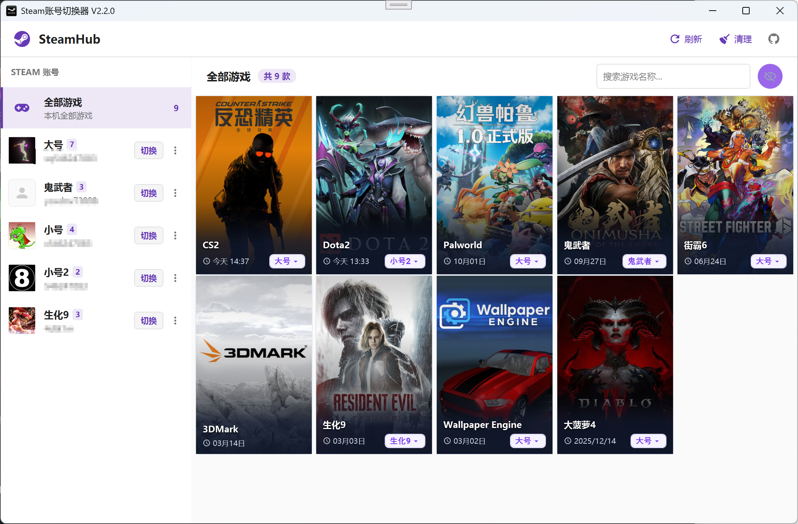
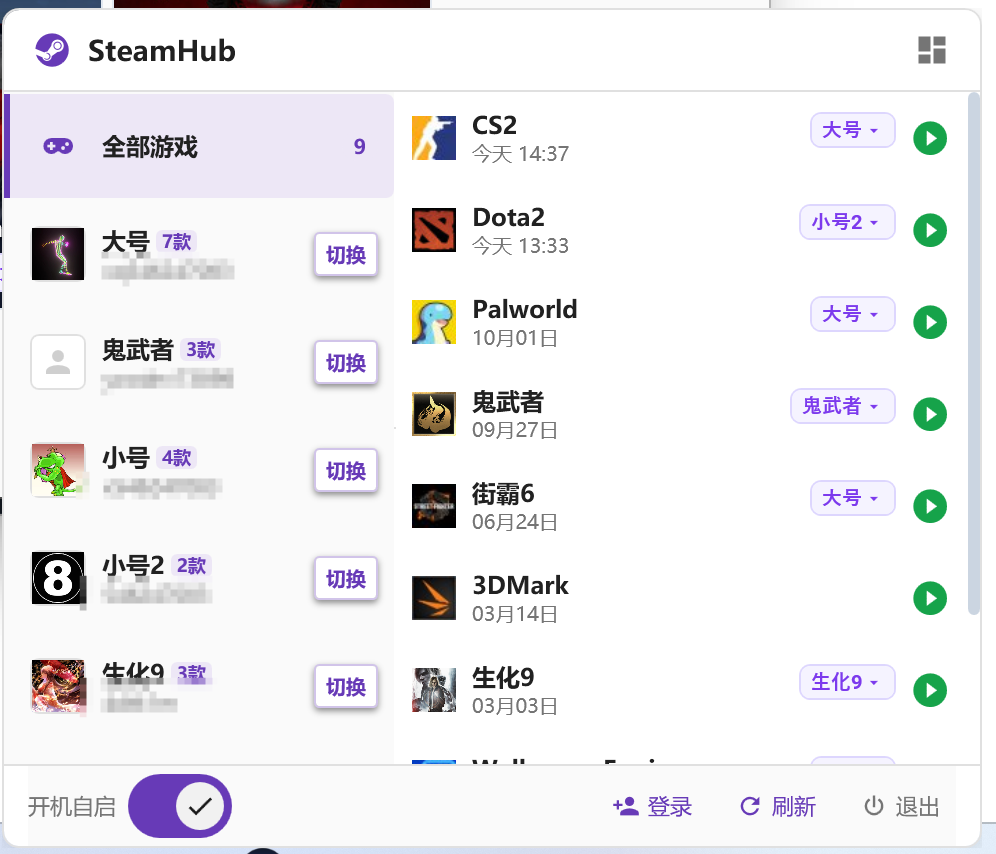

# SteamHub

**开发的起因**: 别人的工具我不敢用,怕有私货,所以开发了这个工具。代码完全开源,您也可以自己编译。

### 账号管理

### 系统托盘

## 📋 功能概览

SteamHub 是一个 Steam 多账号管理工具,帮助您快速切换账号、管理游戏库,无需每次手动输入账号密码。

## 1️⃣ 账号管理

- **刷新** ：程序会自动读取 Steam 本地文件,识别所有登录的账号和已安装的游戏
- **一键清理** ：点击顶栏【清理】按钮，自动扫描并移除本地已不存在的失效账号与游戏记录
- **双击启动** ：双击账号卡片即可快速切换并登录账号
- **拖拽排序** ：拖动账号卡片可自由调整显示顺序
- **隐藏 / 取消隐藏** ：右键账号选择“隐藏”，日常浏览及托盘更清爽；顶栏开启“显示已隐藏”可随时查看与恢复
- **自定义名称** ：首次扫描自动从 Steam 抓取原始名称，用户修改后永久保留，后续刷新不会被覆盖

## 2️⃣ 游戏管理

- 程序会自动分析每个账号的游戏记录,将游戏关联到**最后一次游玩**的账号
- **双击启动** ：双击游戏卡片即可启动游戏
- **智能切换**: 如果当前登录的账号与游戏所属账号不一致,程序会:
  1. 先自动切换到游戏所属账号
  2. 再启动游戏
- **拖拽排序** ：拖动游戏卡片可自由调整显示顺序
- **隐藏 / 取消隐藏** ：游戏同样支持右键隐藏，托盘弹窗与主列表同步隐藏
- **自定义游戏名** ：支持自定义修改游戏名称，刷新库时不会丢失自定义设置

## 3️⃣ 进程管理

- 切换账号前,可以自动关闭指定的进程
- 在 **"设置"** 中管理进程列表:
  - 从系统运行中的进程列表选择

## 4️⃣ 系统托盘

- **双击托盘图标**: 显示主窗口
- **托盘快捷弹窗**:
  - **账号列表与游戏联动**: 快速查看各账号及名下未隐藏游戏，支持一键切换账号并直达游戏启动
- **右键托盘图标**: 
  - **快速切换账号**
  - **登录新账号**
  - **设置开机自启动**
  - 退出程序

## 5️⃣ 常见问题 (FAQ)

### Q: 点击"刷新"后没有显示账号?
**A**: 请确认:
- 已正确安装 Steam
- 至少登录过一次 Steam

### Q: 游戏列表显示不全?
**A**: 只有**已安装**的游戏才会显示

### Q: 如何移除不需要的账号或已卸载的游戏?
**A**:
- **隐藏**: 右键卡片选择“隐藏”，可在界面中隐藏该项（日常和托盘均不再显示），顶栏开启“显示已隐藏”即可随时取消隐藏。
- **物理清理**: 若游戏已卸载或账号已在 Steam 本地被移除，点击顶栏【清理】（扫帚图标）按钮，即可一键从数据库中彻底清除失效数据。

### Q: 为什么刷新后我的自定义修改没有被重置？
**A**: 程序在初次添加时从 Steam 本地读取初始名称，后续刷新会优先保留用户自定义修改的名称，无需担心刷新被覆盖。

### Q: 密码安全吗?
**A**: 密码仅保存在本地 SQLite 数据库,**不会上传到任何服务器**。代码完全开源,您可以自行审查。

## 6️⃣ 快捷操作

| 操作 | 方法 |
|------|------|
| 切换账号 | 双击账号卡片 / 托盘菜单选择账号 |
| 启动游戏 | 双击游戏卡片 / 托盘弹窗游戏卡片 |
| 隐藏/取消隐藏 | 右键卡片 → "隐藏" / "取消隐藏" |
| 一键清理失效数据 | 工具栏 → "清理" |
| 刷新数据 | 工具栏 → "刷新" |
| 复制账号信息 | 点击卡片复制账号/密码 |
| 编辑账号/游戏 | 点击卡片编辑按钮 |
| 显示主窗口 | 双击托盘图标 |

## 💡 使用建议

1. **首次使用**: 点击"刷新"获取账号和游戏,然后为常用账号保存密码
2. **日常使用**: 通过托盘菜单或弹窗快速切换账号与启动游戏,无需常驻主窗口
3. **多账号游戏**: 启动游戏时会自动切换到对应账号,非常方便
4. **清理与隐藏**: 已卸载的游戏点击“清理”一键移除，不常用的游戏/小号直接“隐藏”，界面更整洁
5. **进程管理**: 如果切换账号时遇到问题,可以在设置中添加需要关闭的进程
